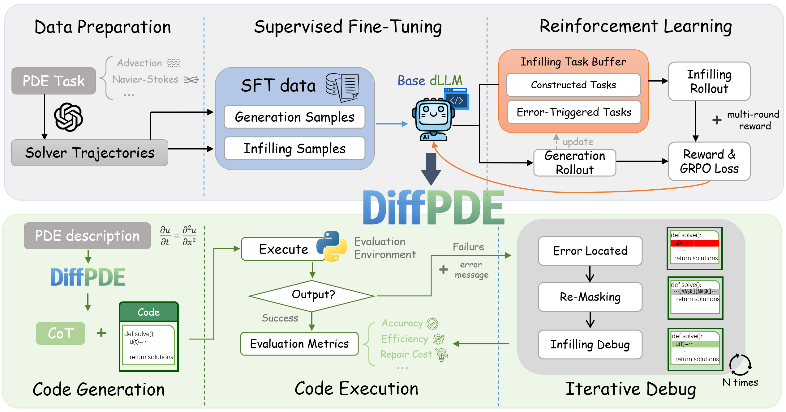

# DiffPDE: Masked Diffusion Language Models as PDE Solver

[Paper](https://arxiv.org/abs/2608.30532) · [Code](https://github.com/GU0vvx/DiffPDE) · **DiffPDE-7B: Coming Soon**  
EMNLP 2026 Findings



## Overview

DiffPDE generates PDE solvers with a masked diffusion language model and uses execution feedback to repair faulty code. This repository contains the PDE-specific implementation; it overlays a pinned [dLLM-RL](https://github.com/Gen-Verse/dLLM-RL) checkout and loads solver templates, task prompts, and evaluators from a separate [CodePDE](https://github.com/LithiumDA/CodePDE) checkout.

- **Localized Re-masking & Infilling:** locate an erroneous region, mask that span while preserving surrounding code, and infill a repair.
- **Iterative Debugging GRPO (ID-GRPO):** train on generation and debugging trajectories with intermediate execution rewards.

## TODO

- ✅ Source code
- ⏳ DiffPDE-7B checkpoint: coming soon

## Installation

Use Python 3.10. Clone DiffPDE, [dLLM-RL](https://github.com/Gen-Verse/dLLM-RL), and [CodePDE](https://github.com/LithiumDA/CodePDE) as sibling repositories. Check out the dLLM-RL commit required by `scripts/setup_dllmrl.sh`, then prepare its GPU environment following the README at that commit, including a compatible FlashAttention build. From the workspace root, install the DiffPDE code into the compatible dLLM-RL checkout:

```bash
bash DiffPDE/scripts/setup_dllmrl.sh "$PWD/dLLM-RL" "$PWD/CodePDE"
```

In the activated dLLM-RL environment, install DiffPDE's main dependencies:

```bash
python -m pip install -r DiffPDE/requirements/requirements-main.txt
```

Install the numerical evaluator dependencies in a separate Python 3.10 environment:

```bash
python -m pip install -r DiffPDE/requirements/requirements-eval.txt
```


## Quick Start

Run from the workspace root after activating the main environment. Download [PDEBench](https://doi.org/10.18419/darus-2986) data separately; the Burgers example needs `1D_Burgers_Sols_Nu0.1_test.hdf5` in the dataset directory.  
This evaluation command uses `configs/eval.yaml` with 32 candidates per PDE, up to three debugging rounds, 4096 diffusion steps, and a maximum generation length of 4096. The candidate and debugging budgets match the paper's evaluation protocol.

```bash
bash DiffPDE/scripts/evaluate.sh "$PWD/dLLM-RL" \
  "paths.codepde_root=$PWD/CodePDE" \
  paths.evaluator_python=/path/to/evaluator-env/bin/python \
  model=/path/to/local/DiffPDE-7B \
  dataset.root_dataset_folder=/path/to/PDEBench/eval-files \
  experiment.project=../outputs/diffpde_eval_burgers
```

## Training

Construct the data for SFT stages with the scripts in `data/sft/` and place it at `dLLM-RL/data/SFT-A.json`.  
Run the three stages in order:

```bash
# Generation SFT
bash DiffPDE/scripts/train_sft_generation.sh "$PWD/dLLM-RL" \
  model.pretrained_model=/path/to/Dream-Coder-7B

# Infilling-aware SFT
bash DiffPDE/scripts/train_sft_refine.sh "$PWD/dLLM-RL" \
  model.pretrained_model=/path/to/generation-SFT-checkpoint

# ID-GRPO
bash DiffPDE/scripts/train_id_grpo.sh "$PWD/dLLM-RL" \
  model.pretrained_model=/path/to/infilling-SFT-checkpoint \
  "paths.codepde_root=$PWD/CodePDE" \
  paths.evaluator_python=/path/to/evaluator-env/bin/python \
  dataset.root_dataset_folder=/path/to/PDEBench/eval-files
```

## Citation

```bibtex
@inproceedings{guo2026diffpde,
  title     = {DiffPDE: Masked Diffusion Language Models as PDE Solver},
  author    = {Guo, Wenxuan and Hong, Yuyang and Fan, Lubin and Fu, Zhaojin and Chen, Lin and Ding, Kun and Xiang, Shiming},
  booktitle = {Findings of the Association for Computational Linguistics: EMNLP 2026},
  year      = {2026},
  url       = {https://arxiv.org/abs/2608.30532}
}
```

## Acknowledgements

DiffPDE builds on [dLLM-RL](https://github.com/Gen-Verse/dLLM-RL) and [Dream-Coder](https://github.com/DreamLM/Dream-Coder), and uses [CodePDE](https://github.com/LithiumDA/CodePDE) and [PDEBench](https://github.com/pdebench/PDEBench) as external task and evaluation resources.

## License

DiffPDE original contributions use [Apache-2.0](LICENSE). Adapted dLLM-RL files retain their attribution in [THIRD_PARTY_NOTICES.md](THIRD_PARTY_NOTICES.md). The external CodePDE checkout is not covered by DiffPDE's license.
